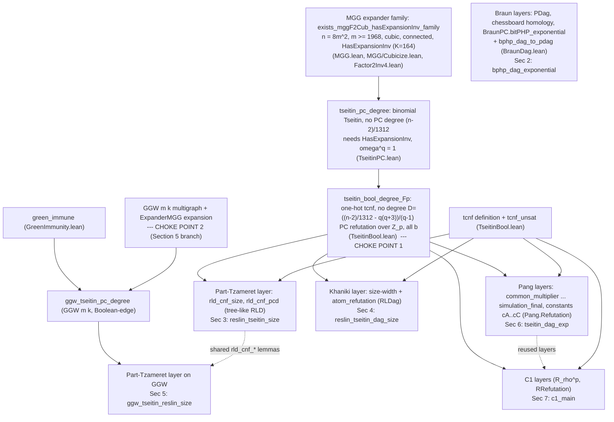

# Statement fidelity dossier (R4, Phase 3.3 preparation)

Status: prepared for independent expert review. Nothing in this document is a certification claim.
Revision note (2026-10-15, branch `r4/referee`, docs only): revised after an outside referee report
(`docs/reports/SATurday_R4_Mathematical_Referee_Report.docx`); point-by-point answer in
`docs/reports/response-to-referee.md`. Changes: Section 1.1 (Tseitin satisfiability criterion corrected),
Section 6.3/6.4 and new Section 11 (novelty), new Sections 11 to 15 (novelty, quantifier shapes, size
parameters, numeric constants and thresholds, dependency diagram), and Section 7 (C1 caveat strengthened).
Repo state described: local `main` at `4f0b4a3` (branch `r4/dossier`, docs only). All Lean text below is
copied from the files named, at that commit. Anything marked UNVERIFIED was not checked by the author of
this dossier.

## 0. Scope and non-claims (read first)

What R4 asks (pin `AC0pFregeLB p` in `theory/Theory/ProofComplexity/AC0pFrege.lean`): for every prime `p`,
a polynomial-size family of unsatisfiable CNFs `Fam n` such that, for every fixed depth `d` and every `c`,
all sufficiently large `n`, every depth-`d` AC0[p] Frege refutation of `Fam n` has size greater than `n^c`.
In Lean this is `AC0pFregeFrontier.r4_target`, which is a `sorry` (Frontier namespace, quarantined).

What is NOT proved: no super-polynomial lower bound for AC0[p]-Frege at any depth (not depth 2, not any
constant depth) is proved or claimed. The results below are lower bounds for strictly weaker or different
proof systems: dag-like Res(⊕) (bit pigeonhole), tree-like and dag-like Res(lin F_p) (Tseitin), polynomial
calculus degree, and an intermediate rank-bounded semantic system `R_rho^p`. Phase 2.1 to 2.4 and Phase 3
of `docs/ladder/r4-completion-checklist.md` are unchecked. Statements of this dossier are about the Lean
statements only: that they are proved in Lean (modulo the three standard axioms, Section 9) says nothing
about whether the Lean definitions match the intended mathematics. That is exactly what the reviewer is asked
to assess. The reviewer is not asked to certify R4.

Two source papers (Braun, Pang) are arXiv preprints from September 2026, unrefereed; Braun's abstract states
substantial AI assistance (Section 7).

Conventions. Namespaces: `SATurday.ProofComplexity` is abbreviated `SPC`. All files are in
`theory/Theory/ProofComplexity/`. A CNF is `Finset Clause`, a clause is `Finset Literal`, a literal is a
structure `{var : ℕ, pos : Bool}` (`Resolution.lean`). Literal `⟨v, true⟩` is satisfied when `x_v = true`.

## 1. Shared definitions

### 1.1 One-hot Tseitin mod q on cubic graphs (`TseitinBool.lean`, graphs in `FinGraph.lean`)

Graph: `FinGraph n := Finset (FinEdge n)`, `FinEdge n := {e : Fin n × Fin n // e.1 < e.2}`. So the graphs are
simple undirected graphs on `Fin n`, with an implicit orientation from lesser to greater endpoint.
`IsRegular G d := ∀ v, degree G v = d`.

Formula `tcnf G q b` (`q ≥ 1`, `b : Fin n → ZMod q` the vertex charges), variables `xv e j = Nat.pair (edgeVar e) j`
meaning "edge `e` carries value `j`", `j < q`:
```
def xv (e : FinEdge n) (j : ℕ) : ℕ := Nat.pair (edgeVar e) j
def aloC (e : G) : Clause := (range q).image fun j => ⟨xv e.1 j, true⟩
def amoC (e : G) (j j' : ℕ) : Clause := {⟨xv e.1 j, false⟩, ⟨xv e.1 j', false⟩}
def netAt (v : Fin n) (α : G → ZMod q) : ZMod q :=
  ∑ e, ((if e.1.val.1 = v then α e else 0) - (if e.1.val.2 = v then α e else 0))
def vC (v : Fin n) (α : G → ZMod q) : Clause := (incE G v).image fun e => ⟨xv e.1 (α e).val, false⟩
def tcnf (b : Fin n → ZMod q) : CNF :=
  (univ.image (aloC G q)) ∪
    ((univ ×ˢ (range q ×ˢ range q)).filter (fun x : G × ℕ × ℕ => x.2.1 ≠ x.2.2)).image
      (fun x => amoC G x.1 x.2.1 x.2.2) ∪
    ((univ ×ˢ univ).filter (fun x : Fin n × (G → ZMod q) => netAt G q x.1 x.2 ≠ b x.1)).image
      (fun x => vC G q x.1 x.2)
```
Plain English: each edge carries exactly one value in `Z_q` (at-least-one and at-most-one clauses), and at each
vertex `v` the net flow (sum of values on edges where `v` is the smaller endpoint minus sum where `v` is the
larger endpoint) equals `b v` mod `q`; each forbidden local labelling is one clause of width `deg v = 3`.
Satisfiability criterion (CORRECTED; the previous text said "unsatisfiable iff `∑ b ≠ 0`", which is false for
disconnected graphs). For an arbitrary finite graph `G`: `tcnf G q b` is satisfiable if and only if
`∑_{v ∈ C} b v = 0 (mod q)` for every connected component `C` of `G` (the net-flow equations in a component sum
to `0`, since each edge value is added at one endpoint and subtracted at the other; conversely, on a connected
component one fixes values on a spanning tree from the leaves up and the root equation is the component sum).
Counterexample to the total-charge criterion: `G` the disjoint union of two copies of `K_4` (3-regular), `q = 2`,
charge `1` on one vertex of each copy and `0` elsewhere: total charge `2 = 0`, yet each component sums to `1`, so
the formula is unsatisfiable. What Lean proves: only the direction "some component sum nonzero implies
unsatisfiable", and only in the weaker form `theorem tcnf_unsat {b} (hb : ∑ v, b v ≠ 0) : ¬ Satisfiable (tcnf G q b)`
(total sum, hence one component sum, nonzero; this hypothesis is sufficient on any graph, connected or not, and is
the direction every lower bound here needs for non-vacuity). The converse (zero component sums imply satisfiable)
is NOT stated or proved in Lean for `tcnf`, and no theorem in the repository uses it (grep for `Satisfiable (tcnf`
finds only `tcnf_unsat`). Where connectivity is actually used: nowhere in `tcnf_unsat`. The graphs of Sections
3, 4, 6, 7 are connected (the family theorem `exists_mggF2Cub_hasExpansionInv_family` returns `G.IsConnected`
and, independently, `HasExpansionInv` forces connectivity: a union of components of at most `n/2` vertices would
be a nonempty set with empty boundary). On a connected graph the criterion reduces to `∑ b ≠ 0` iff unsatisfiable,
and that is the only place where "iff total charge nonzero" is correct. Caveat on the displayed theorems: they
state `IsRegular G 3` but not `G.IsConnected`, because the connectivity conjunct is dropped when the family is
repackaged (`tseitin_bool_degree_Fp` destructures `hconn` and does not use it; the degree argument
`tseitin_pc_degree` uses only `HasExpansionInv`). So the reader cannot read connectivity off the final statements;
it is a property of the witness, visible in the proofs. For `b` whose component sums are all zero the formula is
satisfiable and every statement below is vacuously true for that `b`; for the connected family this means exactly
`∑ b = 0`. Non-vacuity of the hypothesis "a refutation exists" is a separate matter (Section 10, item 6).

Graph family: `exists_mggF2Cub_hasExpansionInv_family` (`MGG/Cubicize.lean`): for every `N` there is `n ≥ N`
and a connected cubic simple graph `G` on `n` vertices with `HasExpansionInv G mggF2CubK` (every nonempty
`S` with `2|S| ≤ n` has `|S| ≤ K |∂S|`). It is a cubicized version of a Margulis/Gabber-Galil torus graph.
It is an existence statement over `n` (the theorems give `∃ n G`, not a bound for all `n`). Reading the proof
(not stated in the theorem): the witness is `n = 8 m²` with `m = max(6, N', 1968)`, `N'` the requested lower
bound, i.e. an indexed family `m ↦ G_m` on `8 m²` vertices. See Section 12.

### 1.2 Polynomial calculus (`PolyCalc.lean`)

```
inductive PCD (Ax : Set (MvPolynomial ℕ F)) (d : ℕ) : MvPolynomial ℕ F → Prop
  | ax {f} : f ∈ Ax → f.totalDegree ≤ d → PCD Ax d f
  | bool (i : ℕ) : 2 ≤ d → PCD Ax d (X i ^ 2 - X i)
  | lin {f g} (a b : F) : PCD Ax d f → PCD Ax d g → PCD Ax d (C a * f + C b * g)
  | mul {f} (i : ℕ) : PCD Ax d f → (X i * f).totalDegree ≤ d → PCD Ax d (X i * f)
def clausePoly (C : Clause) : MvPolynomial ℕ F := ∏ l ∈ C, litPoly l
def litPoly (l : Literal) : MvPolynomial ℕ F := if l.pos then 1 - X l.var else X l.var
def cnfAx (Φ : CNF) : Set (MvPolynomial ℕ F) := {f | ∃ C ∈ Φ, f = clausePoly C}
```
A degree-`d` PC refutation of `Φ` over `F` is `PCD (cnfAx Φ) d 1`. Boolean axioms `x²-x` are included. This is
the standard polynomial calculus with the clause polynomial = 1 exactly on falsifying assignments.

### 1.3 Res(lin F_p) (`ResLinF.lean`, `ResLinFPC.lean`, `ResLinFDag.lean`)

```
abbrev LEq (F : Type) [Field F] := (ℕ →₀ F) × F           -- equation  ∑ c_i x_i = a
def cmb (α β : F) (e1 e2 : LEq F) : LEq F := (α • e1.1 + β • e2.1, α * e1.2 + β * e2.2)
def boolCl (i : ℕ) : Finset (LEq F) := {(Finsupp.single i (1 : F), 0), (Finsupp.single i (1 : F), 1)}
def boolAx : Set (Finset (LEq F)) := Set.range boolCl
def litEq (l : Literal) : LEq F := (Finsupp.single l.var 1, if l.pos then 1 else 0)
def ofCl (C : Clause) : Finset (LEq F) := C.image litEq

inductive RLD (Ax : Set (Finset (LEq F))) (w : ℕ) : Finset (LEq F) → ℕ → Prop     -- tree-like
  | ax {C} : C ∈ Ax → C.card ≤ w → RLD Ax w C 1
  | weak {L L' s} : RLD Ax w L s → L ⊆ L' → L'.card ≤ w → RLD Ax w L' s
  | comb {A B : Finset (LEq F)} {s1 s2 : ℕ} (e1 e2 : LEq F) (α β : F) :
      RLD Ax w A s1 → RLD Ax w B s2 → e1 ∈ A → e2 ∈ B →
      (A.erase e1 ∪ B.erase e2 ∪ {cmb α β e1 e2}).card ≤ w →
      RLD Ax w (A.erase e1 ∪ B.erase e2 ∪ {cmb α β e1 e2}) (s1 + s2)
  | simp {L s} (c : F) : c ≠ 0 → RLD Ax w (insert ((0 : ℕ →₀ F), c) L) s → RLD Ax w L s

inductive RLDag (Ax : Set (Finset (LEq F))) : Finset (Finset (LEq F)) → Prop        -- dag-like
  | empty : RLDag Ax ∅
  | ax {𝓛} (C) : RLDag Ax 𝓛 → C ∈ Ax → RLDag Ax (insert C 𝓛)
  | weak {𝓛} (L L') : RLDag Ax 𝓛 → L ∈ 𝓛 → L ⊆ L' → RLDag Ax (insert L' 𝓛)
  | comb {𝓛} (A B) (e1 e2 : LEq F) (α β : F) :
      RLDag Ax 𝓛 → A ∈ 𝓛 → B ∈ 𝓛 → e1 ∈ A → e2 ∈ B →
      RLDag Ax (insert (A.erase e1 ∪ B.erase e2 ∪ {cmb α β e1 e2}) 𝓛)
  | simp {𝓛} (L) (c : F) : RLDag Ax 𝓛 → c ≠ 0 → insert ((0 : ℕ →₀ F), c) L ∈ 𝓛 → RLDag Ax (insert L 𝓛)
```
Plain English. A line is a finite disjunction of linear equations `∑ c_i x_i = a` over `F_p` in the variables
`x_0, x_1, …` (the CNF's variables). Rules: axiom (clauses of the CNF read as `x_v = 1` for positive literal,
`x_v = 0` for negative literal, and Boolean axioms `x_i=0 ∨ x_i=1`), syntactic weakening (superset), linear
combination of one equation from each premise (`α e1 + β e2`, arbitrary scalars, removing the two used
equations), deletion of a false constant equation `0 = c`, `c ≠ 0`. A refutation derives the empty line.
Tree-like size `s` = number of axiom leaves (`RLD`, also with a line-width cap `w`; theorems quantify over all
`w`). Dag-like size = `𝓛.card`, the number of distinct lines in the finite set `𝓛` built by `RLDag`, with the
empty line in `𝓛`. There is no multiplication rule (only scalar multiplication through `α, β`).
Soundness in Lean: `RLF.rld_sound`, `RLF.rldag_sound`.

### 1.4 Dag-like Res(⊕) (`ResLin.lean`, `ResLinDag.lean`, bit PHP in `ResLinBPHP.lean`)

```
abbrev LClause := Finset (Finset ℕ × ZMod 2)          -- ∨ of equations  ∑_{w∈S} x_w = a  over F_2
inductive Step (Ax : Set Clause) (P : Finset LClause) : LClause → Prop
  | ax {C : Clause} : C ∈ Ax → Step Ax P (ofClause C)
  | weak {L0 L : LClause} : L0 ∈ P → Imp L0 L → Step Ax P L
  | res {L1 L2 C D : LClause} {f : Finset ℕ} {a : ZMod 2} :
      L1 ∈ P → L2 ∈ P → Imp L1 (insert (f, a) C) → Imp L2 (insert (f, a + 1) D) → Step Ax P (C ∪ D)
inductive Der (Ax : Set Clause) : Finset LClause → Prop
  | empty : Der Ax ∅
  | add {P} {L} : Der Ax P → Step Ax P L → Der Ax (insert L P)
def DagRefutes (Ax : Set Clause) (s : ℕ) : Prop := ∃ P : Finset LClause, Der Ax P ∧ (∅ : LClause) ∈ P ∧ P.card ≤ s
def Imp (L L' : LClause) : Prop := ∀ x, lsatL x L → lsatL x L'
def bphpCNF (l m : ℕ) : CNF :=
  ((univ : Finset (Fin m × Fin m × (Fin l → Bool))).filter fun t => t.1 < t.2.1).image fun t =>
    (univ : Finset (Fin l)).image (fun j => (⟨t.1.val * l + j.val, !(t.2.2 j)⟩ : Literal)) ∪
    (univ : Finset (Fin l)).image (fun j => (⟨t.2.1.val * l + j.val, !(t.2.2 j)⟩ : Literal))
```
Plain English. Lines are disjunctions of parity equations over `F_2`. A line is derived by: an axiom clause;
a semantic weakening of one earlier line (`Imp`: every assignment satisfying it satisfies the new line, a
semantic, not syntactic, condition); or resolution of semantic weakenings of two earlier lines on a linear form
`f` (from `C ∨ f=a` and `D ∨ f=a+1` infer `C ∨ D`). Size = number of distinct lines. This follows the
Itsykson-Sokolov system with the weakening convention of Efremenko-Garlik-Itsykson (ECCC TR23-187, Sec 2.2),
per the file docstring (UNVERIFIED by this dossier's author against that paper).
Bit PHP `bphpCNF l m`: `m` pigeons, each an `l`-bit string (pigeon `i` is variables `i*l+j`, `j<l`);
for each pair `i<k` and each `α ∈ {0,1}^l` the clause "pigeon `i` ≠ `α` or pigeon `k` ≠ `α`" (2l literals).
Unsatisfiable when `m > 2^l` (`bphpCNF_unsat`). Lean's `Clause` literals `⟨v, !(α j)⟩` are satisfied when
`x_v = !(α j)`.

---

## 2. Braun's bit pigeonhole bound

### 2.1 Lean statements
File `BraunAssembly.lean` (namespace `SATurday.ProofComplexity.RL.Braun`; underlying `BraunPC.bitPHP_exponential`,
`BraunPC.bitPHP_superpolynomial` in the same file), definitions in `BraunDag.lean`.

```
abbrev PClause (σ : Type) := Finset ((σ → ZMod 2) →ᵃ[ZMod 2] ZMod 2)
def holds {σ : Type} (C : PClause σ) (x : σ → ZMod 2) : Prop := ∃ g ∈ C, g x = 1
def entails {σ : Type} (C D : PClause σ) : Prop := ∀ x, holds C x → holds D x
inductive PStep {σ : Type} {S : ℕ} (I : Set (PClause σ)) (C : Fin S → PClause σ) (i : Fin S) : Prop
  | initial : C i ∈ I → PStep I C i
  | weaken (a : Fin S) : a < i → entails (C a) (C i) → PStep I C i
  | resolve (a b : Fin S) (A B : PClause σ) (u : (σ → ZMod 2) →ᵃ[ZMod 2] ZMod 2) :
      a < i → b < i → C a = insert u A → C b = insert (opp u) B → C i = A ∪ B → PStep I C i
  | binary (a b : Fin S) : a < i → b < i →
      (∀ x, holds (C a) x → holds (C b) x → holds (C i) x) → PStep I C i
def PDag {σ : Type} {S : ℕ} (I : Set (PClause σ)) (C : Fin S → PClause σ) : Prop := ∀ i, PStep I C i
abbrev BitVar (m l : ℕ) := Fin m × Fin l
def usualInitials (m l : ℕ) : Set (PClause (BitVar m l)) :=
  {C | ∃ i i' : Fin m, i < i' ∧ ∃ z : Fin l → ZMod 2, C = usualCNFClause i i' z}
def BraunBitPHP : Prop :=
  ∀ K : ℝ, 0 < K → ∃ L : ℕ, ∀ l ≥ L, ∀ {S : ℕ} (C : Fin S → PClause (BitVar (2 ^ l + 1) l)),
    PDag (usualInitials (2 ^ l + 1) l) C → ∀ f : Fin S, C f = ∅ → ((2 ^ l : ℕ) : ℝ) ^ K < (S : ℝ)
```
(`usualCNFClause i i' z` = the set of affine literals `x ↦ x_{i,t} + z_t`, `t<l`, together with the same for `i'`.)

Headline theorems, verbatim:
```
theorem braunBitPHP : BraunBitPHP

theorem bphp_dag_superpolynomial (K : ℝ) (hK : 0 < K) :
    ∃ L : ℕ, ∀ l ≥ L, ∀ s : ℕ, DagRefutes (↑(bphpCNF l (2 ^ l + 1)) : Set Clause) s →
      ((2 ^ l : ℕ) : ℝ) ^ K < (s : ℝ)

theorem bphp_dag_exponential (l : ℕ) (hl : 32 ≤ l) (s : ℕ)
    (hs : DagRefutes (↑(bphpCNF l (2 ^ l + 1)) : Set Clause) s) :
    Real.exp (((2 ^ l : ℕ) : ℝ) / (32768 * (l : ℝ) ^ 2)) < (s : ℝ)
```
and the affine-DAG exponential form (`BraunPC.bitPHP_exponential`):
```
theorem bitPHP_exponential : ∀ ℓ ≥ 32, ∀ {S : ℕ}
    (C : Fin S → FiniteParityClause (BitVar (2^ℓ+1) ℓ))
    (_dag : RL.Braun.PDag (usualInitials (2^ℓ+1) ℓ) C)
    (finish : Fin S), C finish = ∅ →
    Real.exp (((2^ℓ:ℕ):ℝ)/(32768*(ℓ:ℝ)^2)) < (S:ℝ)
```

### 2.2 Plain mathematics
Let `n = 2^ℓ`. Bit PHP: `n+1` pigeons, each is an `ℓ`-bit string, constraint "no two pigeons have the same string"
(clauses of width `2ℓ`). Superpolynomial: for every real `K>0` and all sufficiently large `ℓ`, every dag-like
Res(⊕) refutation (as defined in 1.4, lines = disjunctions of F_2-affine equations) has more than `n^K` lines.
Exponential: for `ℓ ≥ 32` more than `exp(n/(32768 ℓ²)) = 2^{Ω(n/log² n)}` lines. The bounds are proved for the
affine DAG calculus `PDag` (a larger system, see 2.4) and transferred to `DagRefutes` by `bphp_dag_to_pdag`
(`BraunDag.lean`), which converts an `s`-line `DagRefutes` derivation into a `PDag` with `S ≤ s` nodes whose
initial clauses are exactly `usualInitials`, ending in the empty clause.

### 2.3 Source
K. Braun, "An exponential lower bound for the bit pigeonhole principle in resolution over parities",
arXiv:2609.23015 (submitted 19 Sep 2026, cs.CC), 37 pages. Abstract (as retrieved): arbitrary dag-like
refutations of bit PHP; translation to low-degree polynomial calculus over extension variables, then a degree
bound via homology of chessboard complexes. Main theorem as retrieved: `n+1` pigeons, `n = 2^ℓ`, `ℓ ≥ 32`, every
DAG-like Res(⊕) refutation has more than `exp(n/(32768 ℓ²))` clauses. Theorem and constants match
`bitPHP_exponential`. Theorem numbers in the paper were not retrieved. The paper ships its own Lean development
(files `AffineFamilyExclusion`, `BitPHPClauseTransfer`, `BitPHPExponential`, `BitPHPSuperpolynomial`, per the
port plan `docs/ladder/rungs/r4-braun-port-plan.md`); our Lean is an independent re-proof of the statements.
The superpolynomial statement is Braun's `bitPHP_superpolynomial` (quoted from the port plan, not re-read from
the paper). Our file's docstring says "statements keep his quantifier shape".

Superseded asymptotically (added after referee review; checked against the arXiv text of Pang): Pang
arXiv:2610.00837 Theorem 7.2(e) proves `exp(Ω(N))` for bit-PHP with `N < m = O(N)` pigeons and `N = 2^ℓ` holes in
Res(PC_r/F_p), and Section 7.1 states that for `p = 2`, `r = 1` this improves Braun's `exp(Ω(N/log² N))` for
Res(⊕_2), noting it is tight up to the constant (tree-like refutation of size `2^{O(N)}`). So Braun's bound is no
longer the strongest known bound for bit-PHP in Res(⊕). The value of the Braun development in this repository is
that it is a second, independent proof method (chessboard-complex homology), formalized in full, and the only
route in the repo whose system `PDag` includes a semantic binary rule; it is not a new or best lower bound.
Size parameters for bit-PHP are in Section 13.

### 2.4 Differences
| # | Difference | Direction |
|---|-----------|-----------|
| 1 | The Lean bound is proved first for Braun's affine calculus `PDag` (rules: initial, semantic weakening, resolution on an affine map, and a binary semantic-consequence rule `binary`), then specialised to `DagRefutes`, which has fewer rules (ax, weak, res). `DagRefutes` embeds into `PDag`. A lower bound for the larger system is stronger than one for the smaller one. | strengthens relative to a Res(⊕) with only these rules; neutral relative to the source, which states it for the same affine DAG |
| 2 | Weakening is semantic (`Imp`/`entails`), as in EGI's convention, not syntactic superset. Allowing semantic weakening gives a stronger system, hence a stronger lower bound than for a purely syntactic system. | strengthens (if the reference Res(⊕) is syntactic); neutral for EGI convention |
| 3 | `PDag` is `Prop`-valued (existence of a dag); the paper's `AffineDAG` is `Type`-valued data. Stated equivalent in `BraunDag.lean`/`BraunAssembly.lean` (`pdag_to_affineDAG`, UNVERIFIED by the reviewer-facing author). | neutral |
| 4 | Variable encoding: Lean `bphpCNF` uses `ℕ`-indexed variables `i*l+j`; `PDag` uses `BitVar m l = Fin m × Fin l`; the bridge extends assignments by zero (`ext`, `holds_toP`). Literal sign convention differs (`z_t` offset) but is bridged by `bphp_dag_to_pdag`. | neutral (needs the reviewer check 2.5(b)) |
| 5 | Size measure: number of distinct lines `P.card ≤ s` (`DagRefutes`); number of nodes `S` in `PDag` (sequence, repetitions allowed). The paper's measure is the number of clauses (nodes). | neutral |
| 6 | Pigeon count `2^ℓ+1`, holes `2^ℓ`: same as the source. Threshold `ℓ ≥ 32` and constant `32768` are the same as the source's main theorem (as retrieved). `bphp_dag_exponential` is stated for `exp`, base `e`. | neutral |
| 7 | Formulation of "refutation" requires the empty line in the set, no axiom of Lean's CNF beyond `bphpCNF`. Source's initial clauses are `usualInitials` (same family). | neutral |

### 2.5 Reviewer checks
(a) Non-vacuity of the system: `bphpCNF_unsat` and `bphp_dagRefutable : ∃ s, DagRefutes (bphpCNF l m) s`
for `m > 2^l` exist (`ResLinBPHP.lean`, `ResLinDag.lean`), so refutations exist. (b) Check that `usualCNFClause`
with `labelBitLiteral (x_{i,t} + z_t)` encodes "pigeon `i` has label `z` or pigeon `i'` has label `z`" negated
correctly (the clause is satisfied unless both pigeons equal `z`: literal true when `x_{i,t} ≠ z_t`), and that
it matches `bphpCNF` clause for clause (`bphp_dag_to_pdag`). (c) Check `Step.res`/`PStep.resolve` is sound
(Lean proves `RL.dag_sound`). (d) Check that semantic weakening and the `binary` rule do not make the system
unreasonably strong relative to what the community calls dag-like Res(⊕); note they only strengthen the lower
bound. (e) Check the quantifier `∀ l ≥ L` and that `L` depends on `K`. (f) Compare with the paper's Lean
development rather than only the paper.

### 2.6 Axioms
Output of `#print axioms` (Section 9): `braunBitPHP`, `bphp_dag_superpolynomial`, `bphp_dag_exponential` each
depend on exactly `[propext, Classical.choice, Quot.sound]`.

---

## 3. Part-Tzameret tree-like Res(lin F_p) size for one-hot Tseitin

### 3.1 Lean statement (`ResLinTseitin.lean`)
```
theorem reslin_tseitin_size (p : ℕ) [Fact p.Prime] {q : ℕ} [NeZero q] (hq : 2 ≤ q)
    (hpq : ¬ p ∣ q) (N : ℕ) :
    ∃ (n : ℕ) (G : FinGraph n), N ≤ n ∧ IsRegular G 3 ∧ ∀ b : Fin n → ZMod q, ∀ w s : ℕ,
      RLF.RLD (((fun C => (RLF.ofCl C : Finset (RLF.LEq (ZMod p)))) '' tcnf G q b) ∪ RLF.boolAx)
        w ∅ s →
      2 ^ ((((n - 2) / 1312 - q * (q + 3)) / (q - 1) - (q + 3) - p) / (p - 1)) ≤ 2 * s
```
Also the width companion `reslin_tseitin_width` (same file).

### 3.2 Plain mathematics
For primes `p ∤ q`, `q ≥ 2` (`q` need not be prime in the Lean statement), and every `N`, there is a cubic
expander `G` on `n ≥ N` vertices such that for every charge vector `b`, every tree-like Res(lin F_p) refutation
(Section 1.3, with Boolean axioms and the one-hot CNF `tcnf G q b` as leaves, lines of arbitrary width `w`) with
`s` leaves satisfies `2s ≥ 2^E`, `E = ⌊(⌊(⌊(n-2)/1312⌋ - q(q+3)) / (q-1)⌋ - (q+3) - p) / (p-1)⌋` (natural-number
division, truncated subtraction). For large `n`, `E ≥ n / (1312 (q-1)(p-1)) - O(1)`, so `s = 2^{Ω(n)}`. The
theorem does not itself assert `E > 0`; the reader must take `N` large.
Proof route in Lean: PC degree lower bound `tseitin_bool_degree_Fp` (no degree
`D = ((n-2)/1312 - q(q+3))/(q-1)` PC refutation of `tcnf G q b` over `ZMod p`), plus the Part-Tzameret
size-to-width and width-to-degree transfers (`RLF.rld_cnf_size`, `RLF.rld_cnf_pcd`).

### 3.3 Source
F. Part, I. Tzameret, "Resolution with Counting: Dag-Like Lower Bounds and Different Moduli", ITCS 2020
(LIPIcs 151, 19:1-19:37); Computational Complexity 30 (2021); arXiv:1806.09383 (earlier title "Lower Bounds over
Different Moduli"). The repo's own notes (`docs/ladder/rungs/r4-phase22-plan.md`) state that Theorems 44
(tree-like size-width), 45 (width to PC degree) and Corollary 46 (tree-like Tseitin mod p lower bound
`2^{Ω(dn)}` for `d`-regular Ramanujan graphs, `d ≥ d0(p)`, any finite field of characteristic ≠ p) were read
against arXiv v2 Sections 2.3.2 and 7, not the journal version. This dossier's author confirmed the paper's
existence, authors, venue and arXiv number via search but could NOT re-extract the theorem numbers and
statements (the PDF text was not machine-readable here). Theorem numbers are therefore UNVERIFIED by this
dossier.

### 3.4 Differences
| # | Difference | Direction |
|---|-----------|-----------|
| 1 | Formula: source Cor 46 uses the Boolean-edge Tseitin formula (one Boolean variable per directed edge, equations mod `q`). Lean uses the one-hot encoding `tcnf` with `q` variables per edge. The lower bound for one does not imply the other. | weakens (does not prove the source's instance); different formula |
| 2 | Graph family: source, `d`-regular Ramanujan graphs, `d ≥ d0(p)` large; bound `2^{Ω(dn)}`. Lean: a specific family of cubic expanders (`d = 3`), bound `2^{Ω(n)}`. | weakens (degree 3 only, smaller exponent) |
| 3 | The roles of the primes: source "Tseitin mod p, char(F) ≠ p"; Lean `p` is the field characteristic and `q` the modulus, `q ≥ 2` arbitrary (not nec. prime), `p ∤ q`. | strengthens in modulus generality (q composite allowed); neutral otherwise |
| 4 | Field: source any finite field `F` with char ≠ modulus; Lean only `ZMod p` (prime fields). | weakens |
| 5 | Rules: `RLD` has weakening, linear combination, false-constant deletion, no explicit multiplication (scalar multiplication through `α, β`). Repo plan item 2 flags a possible gap in the paper's Theorem 45 Case 4 and says the Lean transfer uses a variant with degree `w+1` and a side condition; "unverified whether the variant is as strong as the paper's system". The Lean theorem is about the Lean `RLD` as displayed, so the reviewer should check `RLD` against the paper's Res(lin F). | unknown, mark for review |
| 6 | Size measure: number of axiom leaves `s`, bound `2^E ≤ 2s`; source: size of a tree-like refutation (leaves/lines). Any tree-like size measure is within a factor 2 of leaves. | neutral |
| 7 | Constants: explicit and small (`1312`, `q(q+3)`), source asymptotic only. | neutral |
| 8 | Charge `b` arbitrary in Lean; satisfiable cases (`∑ b = 0`) are vacuous. Source requires `σ` with the formula unsatisfiable. | neutral |

### 3.5 Reviewer checks
(a) Non-vacuity: `tcnf_unsat` (formula is unsatisfiable when `∑ b ≠ 0`), and `RLF.rld_sound`. Existence of
some tree-like refutation (an upper bound) of `tcnf` in `RLD` is NOT proved in the repo for this formula, so
non-vacuity of the hypothesis "a refutation exists with `s` leaves" is not shown by Lean (an exponential
upper bound exists in principle by simulating tree-like resolution; UNVERIFIED in Lean). (b) Check `tcnf`
faithfully encodes Tseitin mod `q` (every edge exactly one value; vertex clause per forbidden labelling;
orientation lesser to greater). (c) Check `ofCl`/`litEq` direction (positive literal ↦ `x = 1`). (d) Check
`RLD.comb` is the standard Res(lin) rule and that false-constant `simp` deletion is standard. (e) Check
arithmetic: `E` positive for large `N`. (f) Check `exists_mggF2Cub_hasExpansionInv_family` produces genuine
cubic expanders and that `tseitin_bool_degree_Fp` is a correct PC degree bound (this is the main input; the
source of this is "Buss-Grigoriev-Impagliazzo-Pitassi style", per repo notes, not a single cited theorem).

### 3.6 Axioms
`reslin_tseitin_size`: `[propext, Classical.choice, Quot.sound]`.

---

## 4. Khaniki's dag-like bound

### 4.1 Lean statement (`ResLinDagSize.lean`)
```
theorem reslin_tseitin_dag_size (p : ℕ) [Fact p.Prime] {q : ℕ} [NeZero q] (hq : 2 ≤ q)
    (hpq : ¬ p ∣ q) (N : ℕ) :
    ∃ (n : ℕ) (G : FinGraph n), N ≤ n ∧ IsRegular G 3 ∧ q + 5 ≤ tseitinW p q n ∧
      ∀ b : Fin n → ZMod q, ∀ 𝓛 : Finset (Finset (RLF.LEq (ZMod p))),
        RLF.RLDag (((fun C => (RLF.ofCl C : Finset (RLF.LEq (ZMod p)))) '' tcnf G q b) ∪
          RLF.boolAx) 𝓛 → (∅ : Finset (RLF.LEq (ZMod p))) ∈ 𝓛 →
        ((tseitinW p q n - (q + 3)) * (tseitinW p q n - (q + 3)) <
          72 * (q + 3) * 𝓛.card * (Nat.log 2 (3 * 𝓛.card) + 1)) ∧
        (tseitinW p q n - (q + 3)) * (tseitinW p q n - (q + 3)) /
          (72 * (q + 3) * (Nat.log 2 (3 * ((tseitinW p q n - (q + 3)) *
            (tseitinW p q n - (q + 3))) ) + 1)) ≤ 𝓛.card
```
with `def tseitinW (p q n : ℕ) : ℕ := (((n - 2) / 1312 - q * (q + 3)) / (q - 1)) / (p - 1)`.
Core lemma `RLF.reslin_dag_size_of_pc_degree` (same file): if `Φ` of clause width `≤ w0` has no degree-`D` PC
refutation over `ZMod p` and `4 ≤ D/(p-1)` then every dag Res(lin F_p) refutation with `L` lines satisfies
`(W-K)² < 72 K L (log₂(3L)+1)`, `W = D/(p-1)`, `K = max w0 3`.

### 4.2 Plain mathematics
Same graph family and formula as Section 3. Every dag-like Res(lin F_p) refutation of `tcnf G q b` with `L`
distinct lines satisfies `(W-(q+3))² < 72 (q+3) L (log₂(3L)+1)` with `W ≈ n / (1312 (q-1)(p-1))`, hence
`L log L = Ω(n²)`, i.e. `L = Ω(n²/log n)`, almost quadratic.

### 4.3 Source
E. Khaniki, "On Proof Complexity of Resolution over Polynomial Calculus", ECCC TR20-034 (submitted 12 Mar
2020; Revision 3, 26 Jan 2021, includes PHP); later ACM TOCL 2022 (per a secondary source, NOT checked). The
repo scouting note `docs/ladder/rungs/r4-khaniki-plan.md` verified against the ECCC PDF Rev 3: Theorem 3.1
(size-width for Res(PC_d/R); part 2 dag-like: `w/|R| - 1 ≤ max{3,w(F)} + O(sqrt((2n+3S) log 3S))`),
Corollary 3.2(1) (for `c`-regular Ramanujan graphs, `c ≥ d_q`, `n^{2-(log log n)²/log n} ≤ S` for
Boolean-edge `T_q(G,σ)`), Lemma 4.3 (extension variables), Theorem 5.3 (= Alekhnovich-Razborov PC degree).
This dossier's author did not re-read the PDF.

### 4.4 Differences
| # | Difference | Direction |
|---|-----------|-----------|
| 1 | Formula: one-hot `tcnf` vs paper's Boolean-edge `T_q(G,σ)`. | weakens (not the source's instance) |
| 2 | Graph family: cubic expanders (Lean) vs `c`-regular Ramanujan `c ≥ d_q` (paper). | neutral to weakens (the paper's proof needs only a linear PC degree bound and clause count Θ(n), which the repo's cubic family has) |
| 3 | Bound shape: explicit `(W-(q+3))² < 72 (q+3) L (log₂(3L)+1)` vs asymptotic `n^{2-o(1)}`. For `W = Θ(n)` this gives `L = Ω(n²/log n)`, which is as strong as or stronger than `n^{2-(loglog n)²/log n}`. | neutral to strengthens (the exponent form was not compared line by line) |
| 4 | Proof system: Lean `RLDag` over `ZMod p` with syntactic rules; paper `Res(PC_d/R)` with `d = 1` over a finite field (multiplication of degree 0). Mapped as in Section 3.4 row 5; the paper also counts clauses. | neutral, review |
| 5 | Size: number of distinct lines. The paper: number of clauses (a derivation with repeated clauses has at least as many). | neutral |
| 6 | Superseded by Pang (Section 7) for the exponential bound; retained as the lower-risk almost-quadratic result. | neutral |
| 7 | Lean proves only the stated inequality for the lines; it does not prove `L ≥ n^{2-ε}` in an ε-form. | neutral |

### 4.5 Reviewer checks
(a) Non-vacuity as in 3.5(a). (b) Check that the `atom_refutation` translation (`3L` lines, K variables per
line) matches Khaniki Lemma 4.3 and that dag-like Ben-Sasson-Wigderson (`bsw_dag_size_lower_bound`,
`SizeWidth.lean`) is stated correctly. (c) Check `tseitinW ≥ q+5` assumption is satisfiable by the chosen
`N`. (d) Check natural-number division/subtraction in the displayed statement.

### 4.6 Axioms
`reslin_tseitin_dag_size`: `[propext, Classical.choice, Quot.sound]`.

---

## 5. Exact-formula Alekhnovich-Razborov chain (Boolean-edge Tseitin on a walk multigraph)

### 5.1 Lean statements
`GreenImmunity.lean` (`SPC.Green`):
```
theorem green_immune {q : ℕ} [NeZero q] (hq2 : 2 ≤ q) (hq : (q : F) ≠ 0) (A : Finset ℕ)
    (s : ZMod q) {g : ML F} (hg : g ≠ 0) (hv : ∀ a ∈ ZA q A s, ev a g = 0) :
    (A.card + 1) / q ≤ deg g
```
(`F` a field; `ML F := Finset ℕ →₀ F` multilinear polynomials, `deg g := g.support.sup Finset.card`,
`ev a` evaluation at the Boolean point "set of true variables `a`", `ZA q A s := {a | ((fl A a).card : ZMod q) = s}`,
`fl A a` = the elements of `A` in `a`.)

`GreenTseitin.lean` (`SPC.TseitinEdge`):
```
theorem ggw_tseitin_pc_degree {F : Type} [Field F] {q : ℕ} (hq2 : 2 ≤ q) (hqF : (q : F) ≠ 0)
    {m : ℕ} (hm : 16 * q ≤ m) {k : ℕ} (hk : k0 q ≤ k) (σ : MggTorus m ⊕ MggTorus m → ZMod q)
    {d : ℕ} (hd : (d : ℝ) ≤ (m : ℝ) * m * (8 : ℝ) ^ k / (256 * (q : ℝ) ^ 2)) :
    ¬ PCD ((ggwGraph m (by omega) k).Ax F q σ) d 1
```
`ResLinTseitinEdge.lean`:
```
theorem ggw_tseitin_reslin_size (p : ℕ) [Fact p.Prime] {q : ℕ} (hq2 : 2 ≤ q) (hpq : ¬ p ∣ q)
    {m : ℕ} (hm : 16 * q ≤ m) {k : ℕ} (hk : k0 q ≤ k) (σ : MggTorus m ⊕ MggTorus m → ZMod q)
    {w s : ℕ}
    (h : RLF.RLD (((fun C => (RLF.ofCl C : Finset (RLF.LEq (ZMod p)))) ''
      ((ggwGraph m (by omega) k).cnf q σ)) ∪ RLF.boolAx) w ∅ s) :
    2 ^ ((m * m * 8 ^ k / (256 * q ^ 2) - 8 ^ k - p) / (p - 1)) ≤ 2 * s
```
Definitions (`TseitinEdgeCNF.lean`, `ExpanderParams.lean`, `ExpanderMGG.lean`):
```
structure OGraph (V E : Type) where  src dst : E → V;  col : E → ℕ;  col_inj : Function.Injective col
def OGraph.coef (q) (v : V) (e : E) : ZMod q := (if G.dst e = v then 1 else 0) - (if G.src e = v then 1 else 0)
def OGraph.lsum (q) (v : V) (b : E → Bool) : ZMod q := ∑ e, G.coef q v e * (if b e then 1 else 0)
def OGraph.cl (F) (v : V) (α : E → Bool) : MvPolynomial ℕ F := ∏ e ∈ G.inc v, if α e then X (G.col e) else 1 - X (G.col e)
def OGraph.Ax (F) (q) (σ : V → ZMod q) : Set (MvPolynomial ℕ F) := {p | ∃ v α, G.lsum q v α ≠ σ v ∧ p = G.cl F v α}
def OGraph.clause (v : V) (α : E → Bool) : Clause := (G.inc v).image (G.lit α)     -- lit α e = ⟨G.col e, !α e⟩
def OGraph.cnf (q) (σ : V → ZMod q) : CNF :=
  (Finset.univ.filter fun p : V × (E → Bool) => G.lsum q p.1 p.2 ≠ σ p.1).image fun p => G.clause p.1 p.2
def ggwGraph (m : ℕ) (hm : 3 ≤ m) (k : ℕ) : OGraph (MggTorus m ⊕ MggTorus m) (MggTorus m × (Fin k → Fin 8)) where
  src e := Sum.inl e.1;  dst e := Sum.inr ((ggSys m hm).walkEnd k e.1 e.2);  col e := (Fintype.equivFin _ e : ℕ)
def k0 (q : ℕ) : ℕ := 6 * Nat.clog 2 (32 * q)
abbrev MggTorus (m : ℕ) := Fin m × Fin m
```
(`ggSys m hm` is the 8-step factor-2 Gabber-Galil step system on the torus `(Z/m)²`.)
Supporting statements: `ggw_himm` (`⌊(8^k+1)/q⌋`-immunity of every vertex root set, from `green_immune`),
`ar_thm44_ggw` (`⌊8^k/(4(q-1))⌋`), `ggw_tseitin_no_refutation`, `OGraph.cnfAx_eq` (`cnfAx (G.cnf q σ) = G.Ax F q σ`),
`ggw_expansion`/`ggw_boundary_card` (`ExpanderMGG.lean`).

### 5.2 Plain mathematics
Graph `GGW m k`: bipartite multigraph on `2m²` vertices (two copies of the torus `(Z/m)²`); one edge for every
`k`-step walk (sequence in `{1..8}^k`) from a left vertex to its endpoint in the right copy, oriented left to right.
Every vertex has degree `d = 8^k`, parallel edges allowed. Tseitin mod `q` formula `T_q(G,σ)` (Alekhnovich-Razborov
Definition 4.3): one Boolean variable per edge, at vertex `v` the signed sum of incident edge variables
(`+1` in, `-1` out) equals `σ v` mod `q`, encoded as one clause of width `d` for each falsifying local
assignment. `green_immune`: over a field in which `q` is invertible, a nonzero multilinear polynomial vanishing on
all Boolean points whose weight on an `n`-set `A` is `≡ s (mod q)` has degree `≥ ⌊(n+1)/q⌋` (a Beck-Li/Green
type weak-degree bound). `ggw_tseitin_pc_degree`: for `16q ≤ m`, `k ≥ k0 q`, every `σ`, no polynomial calculus
refutation of degree `≤ m² 8^k/(256 q²)` exists over any field with `q ≠ 0`. `ggw_tseitin_reslin_size`:
tree-like Res(lin F_p) refutations with `s` leaves of the Boolean-edge `T_q` satisfy
`2^((m² 8^k/(256 q²) - 8^k - p)/(p-1)) ≤ 2s`. With `n = 2m²`, `d = 8^k` the exponent is `Ω(dn/(p q²))` for
`m² ≥ ~512 q²`.

### 5.3 Sources
(a) M. Alekhnovich, A. Razborov, "Lower bounds for polynomial calculus: non-binomial case", FOCS 2001 / Proc.
Steklov Inst. Math. 242 (2003): Thm 3.8 (expander criterion), Def 4.3, Thm 4.4 (immunity of mod-`q` predicates),
Cor 4.5 (PC degree `Ω(dn)` for Tseitin mod `q` on suitable graphs). The repo notes used an OCR copy; the OCR
of the immunity formula in Thm 4.4 was garbled and the constant `⌊d/(4(q-1))⌋` was recorded as UNVERIFIED
(`docs/ladder/rungs/r4-expander-plan.md`). (b) F. Green, "A complex-number Fourier technique for lower bounds on
the Mod-m degree", Computational Complexity 9 (2000) 16-38: full text NOT available to the repo authors; the
Lean `green_immune` is instead proved following R. Beck, J. Li, arXiv:1304.0713 Section 5 (elementary
symmetrization and a binomial rank lemma), with extension to general fields and shift `s` reconstructed by the
repo authors (`docs/ladder/rungs/r4-green-note.md`). This dossier's author did not independently re-fetch (a), (b)
or Beck-Li. (c) Part-Tzameret Theorems 44, 45 (as in Section 3.3) for the `ResLinTseitinEdge` step.

### 5.4 Differences
| # | Difference | Direction |
|---|-----------|-----------|
| 1 | Graph: AR/Part-Tzameret use an arbitrary suitable expander (Ramanujan, large degree); Lean proves it only for the explicit multigraph family `GGW m k` (powers of the Gabber-Galil walk), with `d = 8^k`, `k ≥ k0 q = 6⌈log₂(32q)⌉`, `16q ≤ m`. The family has parallel edges (multigraph) and is bipartite with all edges oriented left to right. | weakens (specific family); the formula itself is the AR formula |
| 2 | Immunity constant: Lean gets `⌊(d+1)/q⌋`, larger than AR's `⌊d/(4(q-1))⌋` (`ar_const_le` shows AR's is at most Lean's). Uses Beck-Li-style proof, not Green's Fourier proof. | strengthens |
| 3 | The repo notes record a possible gap in AR's statement of Thm 4.4 (immunity can fail for tiny `d` if the root set is empty); Lean's statement carries explicit side conditions (`k ≥ k0 q`). | neutral |
| 4 | PC degree bound `m² 8^k/(256 q²)` is for any field with `(q : F) ≠ 0`, matching AR Cor 4.5's `Ω(dn)` form with explicit constant. | neutral |
| 5 | Res(lin F_p) tree-like size: same Part-Tzameret transfer as Section 3, now on the exact AR formula, so difference 1 of Section 3.4 (formula) disappears, but the graph restriction remains. Differences 4, 5 of Section 3.4 (prime fields only, rule variant) remain. | neutral to weakens |
| 6 | `q` need only satisfy `2 ≤ q`, `p ∤ q`. | neutral |
| 7 | Clause width `d = 8^k` (grows with `k`); constants depend on `k`, not constant-width as in Section 3. | neutral |

### 5.5 Reviewer checks
(a) Non-vacuity: `OGraph.Ax_unsat` (the system `Ax` has no common Boolean root when `∑ σ ≠ 0`) and soundness of
`PCD`. For `∑ σ = 0` the system is satisfiable and statements are vacuous. (b) Check that `OGraph.cnf`/`clause`/`lit`
yields Definition 4.3 (the clause for `(v,α)` is falsified exactly when the local assignment equals `α`), and
`OGraph.cnfAx_eq`. (c) Check `ggwGraph` is `8^k`-regular on both sides (`ggwGraph_inc_card`) and that the vertex
root set `Z` equals the AR predicate with sign `ε = ±1` (`OGraph.Z_eq`, `ggw_sign`). (d) Check `green_immune`
statement, especially the direction of the vanishing condition (polynomials vanishing ON the class `ZA`), against
Green/Beck-Li (the repo's own note flags this "convention trap"). (e) Check that the arithmetic of the side
conditions in `ggw_tseitin_no_refutation` (`num_bounds`) is right; it is proved, but its statement is the
reviewer's check that the AR expander criterion (Thm 3.8) was transcribed with the right parameters
(`r`, `s`, `c`, `l > 4(s-c)`). (f) For the uniform-sign root set, check `ggw_J_card = 8^k`. (g) Natural-number
division in `ggw_tseitin_reslin_size`.

### 5.6 Axioms
`ggw_tseitin_pc_degree`, `ggw_tseitin_reslin_size`, `green_immune`: each `[propext, Classical.choice, Quot.sound]`.

---

## 6. Pang's theorem (dag-like Res(lin F_p), exponential, one-hot Tseitin)

### 6.1 Lean statement (`PangTseitin.lean`; system in `PangDag.lean`; constants in `PangParams.lean`)
```
theorem tseitin_dag_exp (p : ℕ) [Fact p.Prime] {q : ℕ} [NeZero q] (hq : 2 ≤ q) (hpq : ¬ p ∣ q)
    (N : ℕ) :
    ∃ (n : ℕ) (G : FinGraph n), N ≤ n ∧ IsRegular G 3 ∧ ∀ b : Fin n → ZMod q,
      ∀ R : Pang.Refutation (tcnf G q b) (tVars G q) p, 2 ^ (n / cC p q) ≤ R.S
```
System, verbatim from `PangDag.lean`:
```
abbrev Poly (p) [Fact p.Prime] := MvPolynomial ℕ (ZMod p)
abbrev Line (p) [Fact p.Prime] := Finset (Poly p)
def clauseLine (C : Clause) : Line p := C.image fun l => (litPoly l : Poly p)
def WF (V : Finset ℕ) (L : Line p) : Prop := ∀ h ∈ L, h.totalDegree ≤ 1 ∧ ∀ v ∈ h.vars, v ∈ V
inductive Infer (Φ : CNF) (V : Finset ℕ) : List (Line p) → Line p → Prop
  | init (C : Clause) (hC : C ∈ Φ) : Infer Φ V [] (clauseLine C)
  | zero : Infer Φ V [] {0}
  | bool (i : ℕ) (hi : i ∈ V) : Infer Φ V [] {X i, X i - 1}
  | weak {L : Line p} (L' : Line p) (h : L ⊆ L') : Infer Φ V [L] L'
  | falseConst {L : Line p} (c : ZMod p) (hc : c ≠ 0) (hmem : (C c : Poly p) ∈ L) (L' : Line p)
      (h : L.erase (C c) ⊆ L') : Infer Φ V [L] L'
  | comb {L₁ L₂ : Line p} {f g : Poly p} (hf : f ∈ L₁) (hg : g ∈ L₂) (a b : ZMod p) (L' : Line p)
      (h : insert (C a * f + C b * g) (L₁.erase f ∪ L₂.erase g) ⊆ L') : Infer Φ V [L₁, L₂] L'
  | mul {L : Line p} {f : Poly p} (hf : f ∈ L) (g : Poly p) (hdeg : (f * g).totalDegree ≤ 1)
      (hvars : ∀ v ∈ g.vars, v ∈ V) (L' : Line p) (h : insert (f * g) (L.erase f) ⊆ L') : Infer Φ V [L] L'
structure Refutation (Φ : CNF) (V : Finset ℕ) (p : ℕ) [Fact p.Prime] where
  S : ℕ;  line : ℕ → Line p;  prem : ℕ → List ℕ;  S_pos : 0 < S
  prem_lt : ∀ i < S, ∀ j ∈ prem i, j < i
  infer : ∀ i < S, Infer Φ V ((prem i).map line) (line i)
  wf : ∀ i < S, WF V (line i)
  last : line (S - 1) = ∅
```
Constants: `cA q = 2624 q + 1313`, `cLam q = 18 q cA q`, `cS p q = 2(1 + cLam q^(p-1))`,
`cC p q = cA q * (8 (p-1)²) * cS p q`.

### 6.2 Plain mathematics
For primes `p ∤ q`, `q ≥ 2` and every `N` there is a cubic expander on `n ≥ N` vertices such that for every
charge `b`, every dag-like Res(lin F_p) refutation with `S` nodes of the one-hot Tseitin CNF `tcnf G q b`, in which
all lines are disjunctions of equations `h = 0` with `h` of degree `≤ 1` in the variables `tVars G q` of the CNF
(no extension variables), has `S ≥ 2^{⌊n/C⌋}`, `C = cC p q`, which depends only on `p, q`. Lines are sets of
polynomials; nodes with premises as earlier nodes; size = number of nodes (nodes may repeat a line).

### 6.3 Source
S. Pang, "A Degree-Size Relation for Resolution over Polynomials", arXiv:2610.00837 v1 (30 Sep 2026, cs.CC,
cross-listed cs.LO), University of Bristol per repo notes. Abstract (as retrieved): linear PC degree for a
constant-width CNF forces exponential size in resolution over constant-degree polynomials over the same prime
field. Theorem 1.1 per the repo note `docs/ladder/rungs/r4-pang-plan.md` (read from the arXiv TeX): `p` prime,
CNF of width `w` on `n` Boolean variables; if `Q(F)` has no degree-`D` PC refutation with
`D ≥ max{32(p-1)² r, 8w}`, then every dag-like Res(PC_r/F_p) refutation has `ln S ≥ (D/(32 p² r)) (D/(16 n))^{(p-1)r}`.
`r = 1` is Res(lin F_p). The Lean version formalizes `r = 1` only and re-derives the argument with its own constants.
The cubic-expander input comes from `tseitin_bool_degree_Fp` (Section 3). This dossier's author verified the
paper's existence, title, author, date and abstract on arXiv but not the theorem text; the note was written by a
previous session who read the TeX in full and hand-checked each layer.

Checked against the arXiv text (2026-10-15, by this revision): Theorem 1.1 is as quoted above (statement
verified: `D ≥ max{32(p-1)² r, 8 w(F)}`, `ln S ≥ (D/(32 p² r))·(D/(16 n))^{(p-1)r}`). Theorem 7.2 has parts
(a) random CNFs, (b) `Tseitin_q(G,b)` for a fixed prime `q ≠ p` on a family of fixed-degree regular edge
expanders, (c) 3-colouring, (d) PHP variants, (e) bit-PHP; all with `exp(Ω(N))`. The paper's Tseitin encoding has
`q|E|` variables, one block of `q` per edge, with unique-value clauses (a disjunction over values and pairwise
exclusions) and vertex flow-conservation constraints: this is the same one-hot encoding as `tcnf` (the paper does
not call it "one-hot"; clause widths at most `max(q, deg)`). Section 7.1 contains the semantic-weakening
simulation remark. Section 8 describes the AC0[p]-Frege bottleneck. The theorem is therefore NOT new: see
Section 11.

### 6.4 Differences
| # | Difference | Direction |
|---|-----------|-----------|
| 1 | Lean: only `r = 1` (Res(lin F_p)); the paper handles all constant `r`. | weakens (as a reproof of the paper's general theorem); neutral for the Res(lin F_p) instance |
| 2 | Lean specialises to the one-hot Tseitin CNF on the cubic expander family and gives `2^{⌊n/C⌋}` with explicit `C`; the paper's Thm 1.1 is generic in the CNF and PC degree. Lean also proves generic layers (`Pang.exp_of_degree`) but the headline theorem is the Tseitin application. | weakens (specific application) |
| 3 | Syntactic rules plus fusion: in `Infer`, `comb`, `mul`, `falseConst` conclude any superset `L'`, i.e. weakening is fused into those steps. The file docstring says this makes the system at least as strong as Pang's, so a lower bound implies Pang's. The paper's weakening is syntactic; a footnote (l.837 of the TeX) says semantic weakening is simulable with polynomial overhead (UNVERIFIED). | strengthens |
| 4 | No extension variables (all variables in `V = tVars G q`), matching the paper (the paper's proof also avoids them). Lean `bool` requires `i ∈ V`. | neutral |
| 5 | The rule `mul` multiplies by `g` with `(f*g).totalDegree ≤ 1`, i.e. essentially scalars and monomials absorbed; in the paper multiplication by arbitrary polynomials of degree `≤ r`, with `r = 1`. | neutral, review |
| 6 | The dag size `R.S` counts nodes in a list, repetition allowed; the paper counts nodes of the dag. | neutral |
| 7 | Unsatisfiable `tcnf` only for `∑ b ≠ 0`; other `b` vacuous. | neutral |
| 8 | Constant `C` is explicit and huge (`cLam 2 = 236196` and `cC` includes `cLam^(p-1)`); paper's bound has a different, smaller form. | neutral |
| 9a | Novelty (see Section 11): `r = 1`, `q` prime, `p ≠ q`, fixed-degree expanders is exactly the case covered by Pang Theorem 7.2(b); the Lean theorem is a formalization of a published application. Differences: `q` may be composite with `p ∤ q` (Pang 7.2(b) states a fixed prime `q ≠ p`); exact constants; Pang's version is for general `r` and holds for a family of regular edge expanders, ours for one explicit cubic family. | neutral (formalization), strengthens only in `q` composite |
| 9 | The Lean polynomial for a clause is `clauseLine`/`litPoly` (`1 - X` for a positive literal); the repo note flags matching against the paper's `Q(F)` falsity polynomial as UNVERIFIED. | review |

### 6.5 Reviewer checks
(a) Non-vacuity: `Pang.Refutation.unsat` (soundness) and, for existence, that some `Refutation` exists for
unsat CNFs (not proved for `tcnf`; upper bound not formalized in this system, UNVERIFIED). (b) Compare `Infer`
with Pang's definitions (rules, whether `mul` and `falseConst` match; check that fused weakening is harmless).
(c) Check `tVars` is exactly the variable set of `tcnf` (`TseitinSize.lean`), and the bound `V.card` in terms of
`n` (`card_G_ge`, `card_tVars_le`). (d) Check the final inequality direction `2^(n/C) ≤ R.S`. (e) This
result is the one most dependent on a one-month-old preprint; its proof was re-derived, not copied, but the
reviewer should confirm the statement of Thm 1.1 and that the formalized layers (`common_multiplier`,
`onestep`, `prefix_identity`, `Nn_ratio`, `exp_bound`, `simulation_final`) are the statements of the paper's
Lemmas 4.1-4.2, Thm 4.3, Prop 5.1 and Section 6.

### 6.6 Axioms
`Pang.tseitin_dag_exp`: `[propext, Classical.choice, Quot.sound]`.

---

## 7. Bounded-rank result `C1.c1_main`

### 7.1 Lean statement (`C1Final.lean`; system in `C1Rank.lean`)
```
theorem c1_main (p : ℕ) [Fact p.Prime] {q : ℕ} [NeZero q] (hq : 2 ≤ q) (hpq : ¬ p ∣ q)
    (ε : ℝ) (hε : 0 < ε) (hεκ : (kappa p q + 1) * ε < 1) (M : ℕ) :
    ∃ (n : ℕ) (G : FinGraph n), M ≤ n ∧ IsRegular G 3 ∧ ∀ b : Fin n → ZMod q,
      ∀ ρ : ℕ, 1 ≤ ρ → (ρ : ℝ) ≤ ε * Real.log n →
      ∀ R : RRefutation (tcnf G q b) (tVars G q) ρ p,
        Real.exp ((n : ℝ) ^ (1 - (kappa p q + 1) * ε)) ≤ R.S
```
with `def kappa (p q : ℕ) : ℝ := ((p : ℝ) - 1) * Real.log (Pang.cLam q)`. System, verbatim from `C1Rank.lean`:
```
abbrev AffForm (p) [Fact p.Prime] := (ℕ →₀ ZMod p) × ZMod p          -- affine form  ∑ c_i x_i + c_0
abbrev Term (p) := Finset (AffForm p)                                   -- conjunction of  l = 0
def rank (T : Term p) : ℕ := Module.finrank (ZMod p) (Submodule.span (ZMod p) (T : Set (AffForm p)))
abbrev RLine (p) := Finset (Term p)                                     -- disjunction of terms
def Bdd (ρ : ℕ) (L : RLine p) : Prop := ∀ T ∈ L, rank T ≤ ρ
def Supp (V : Finset ℕ) (L : RLine p) : Prop := ∀ T ∈ L, ∀ l ∈ T, l.1.support ⊆ V
def SemOK (T₁ : Term p) (T₂ T₃ : Option (Term p)) : Prop :=
  ∀ a : Assignment, TrueAt (boolPt (F := ZMod p) a) T₁ →
    (∀ T, T₂ = some T → TrueAt (boolPt (F := ZMod p) a) T) →
    ∃ T, T₃ = some T ∧ TrueAt (boolPt (F := ZMod p) a) T
inductive RInfer (Φ : CNF) (ρ : ℕ) : List (RLine p) → RLine p → Prop
  | init (C : Clause) (hC : C ∈ Φ) : RInfer Φ ρ [] (clauseRLine C)
  | taut (i : ℕ) : RInfer Φ ρ [] {{formVar i}, {formVarSub i}}
  | weak {L : RLine p} (L' : RLine p) (h : L ⊆ L') : RInfer Φ ρ [L] L'
  | sem1 {L₁} {T₁} {T₃ : Option (Term p)} (h₁ : T₁ ∈ L₁) (hs : SemOK T₁ none T₃) (L' : RLine p)
      (hL' : L₁.erase T₁ ⊆ L') (hT₃ : ∀ T, T₃ = some T → T ∈ L') (hb : ∀ T, T₃ = some T → rank T ≤ ρ) :
      RInfer Φ ρ [L₁] L'
  | sem2 {L₁ L₂} {T₁ T₂ : Term p} {T₃ : Option (Term p)} (h₁ : T₁ ∈ L₁) (h₂ : T₂ ∈ L₂)
      (hs : SemOK T₁ (some T₂) T₃) (L' : RLine p) (hL₁ : L₁.erase T₁ ⊆ L') (hL₂ : L₂.erase T₂ ⊆ L')
      (hT₃ : ∀ T, T₃ = some T → T ∈ L') (hb : ∀ T, T₃ = some T → rank T ≤ ρ) : RInfer Φ ρ [L₁, L₂] L'
structure RRefutation (Φ : CNF) (V : Finset ℕ) (ρ : ℕ) (p : ℕ) [Fact p.Prime] where
  S : ℕ;  line : ℕ → RLine p;  prem : ℕ → List ℕ;  S_pos : 0 < S
  prem_lt : ∀ i < S, ∀ j ∈ prem i, j < i
  infer : ∀ i < S, RInfer Φ ρ ((prem i).map line) (line i)
  bdd : ∀ i < S, Bdd ρ (line i)
  supp : ∀ i < S, Supp V (line i)
  last : line (S - 1) = ∅
```

### 7.1a What this result is, plainly (added after referee review)
`C1.c1_main` is a lower bound for a bespoke semantic calculus `R_ρ^p` that this repository defined. It is not a
Cook-Reckhow proof system (its semantic rules `sem1`, `sem2` are checked by quantifying over all Boolean
assignments, so correctness of a line is not polynomial-time checkable), it is not a known standard system, and its
rank parameter `ρ` is a dimension of a span of affine forms, not a circuit depth. It gives NO lower bound for
depth-`d` AC0[p]-Frege, for Res(lin F_p) beyond what Section 6 already gives, or for any standard system, unless
one proves a bridge theorem: a translation from the relevant refutations (e.g. depth-`d` AC0[p]-Frege proofs)
into `R_ρ^p` with controlled rank and size. No such theorem is proved, stated, or known to hold; whether
depth-`d` AC0[p] proofs have low-rank `R_ρ^p` representations is the open research question. Read it as a
stand-alone result about a defined calculus, and as evidence of nothing about R4. Pang's Section 8 names the
concrete obstruction for the Frege route (a quantitative tradeoff between approximation degree and rank shrinkage
under iteration over depth; the missing ingredient is PC degree lower bounds near or above `n/2` for
polynomial-size, `o(n)`-width CNFs); C1 does not supply it, since its rank bound is logarithmic.

### 7.2 Plain mathematics
`R_ρ^p`: lines are disjunctions of terms; a term is a conjunction of affine equations `l = 0` over `F_p`
(the equations may be many, but the span of their affine forms, constants included, must have dimension `≤ ρ`).
Rules: initial clause, tautology `x_i = 0 ∨ x_i = 1`, weakening, and two semantic rules: from a term (or two terms
in two premise lines) one may infer any term of rank `≤ ρ` that is implied on the Boolean cube (or infer the empty
clause if the term(s) are unsatisfiable on the cube), keeping the rest of the premise lines. Size is the number
of nodes. The semantic implication is checked by quantifying over all Boolean assignments; this is not a
polynomial-time-verifiable (Cook-Reckhow) proof system. Statement: for primes `p ∤ q`, `ε>0` with
`(κ+1)ε < 1`, `κ = (p-1) ln cLam(q)`, for every `M` there is a cubic expander on `n ≥ M`
vertices such that for every charge `b`, every rank bound `1 ≤ ρ ≤ ε ln n` and every dag-like `R_ρ^p`
refutation of `tcnf G q b` over its own variables, the size is at least `exp(n^{1-(κ+1)ε})`.
The constant `κ` is large (repo note: about 24.7 for `(p,q)=(3,2)`, so `ε` must be below about 1/25.7); the
rank bound `ρ ≤ ε ln n` is logarithmic, not constant or polynomial.

### 7.3 Source
No paper states this theorem. It is a corollary, constructed in this repo, of the layers of Pang
(arXiv:2610.00837, Section 6) re-run for the system `R_ρ^p`; hand analysis in `docs/ladder/rungs/r4-phase23-c1.md`
and the Lean plan `docs/ladder/rungs/r4-c1-lean-plan.md`, which states "Low novelty: a corollary of Pang's method
for the intermediate system `R_ρ^p`" and that the constants differ from the hand note (`κ_Lean` vs 140.9).
Pang's paper treats Res(PC_r/F_p); `R_ρ^p` is NOT Res(PC_r/F_p), it is a semantic rank-restricted term system
(like the "Res(⊕_p)"/Res(lin) generalization but with semantic rules).

### 7.4 Differences
This is not a reproof; the comparison is with the intended meaning in the project plan (a candidate step towards
AC0[p] Frege), and with Pang.
| # | Difference | Direction |
|---|-----------|-----------|
| 1 | Semantic rules `sem1`, `sem2` (inference by semantic consequence on the cube, any term of rank `≤ ρ`); this includes weakening and resolution as special cases and goes beyond any syntactic Res(lin F_p) rule set. A lower bound for this stronger system is stronger. | strengthens relative to Res(lin F_p)/Res(⊕_p)-type systems |
| 2 | But `ρ ≤ ε ln n` only (rank logarithmic in `n`), and `ε` small enough that `(κ+1) ε < 1` with huge `κ`. The result is vacuous for constant rank unless `n` is astronomical; the system for fixed `ρ` is only claimed for `ρ ≥ 1`. | weakens relative to a general rank bound; this is the central caveat |
| 3 | Not a standard system: semantic non-polynomially-verifiable rules; terms are conjunctions of affine equations not formulas with MOD gates; no relation to AC0[p]-Frege depth is formalized. | review |
| 4 | Lines over the CNF's own variables (no extension variables). | neutral |
| 5 | Formula: one-hot Tseitin on the cubic expander family (Section 3). | as in 3.4 |
| 6 | Size measure: number of nodes with repeated lines. | neutral |
| 7 | The bound is in `n` (vertices); the hand note had it in `N = |tVars|`; Lean's is the weaker-looking but implied form since `N ≥ n`. | neutral |

### 7.5 Reviewer checks
(a) Non-vacuity: `RRefutation.unsat` (soundness); existence of refutations in `R_ρ^p` is NOT proved for
`ρ ≥ 1` in general (resolution simulation would give it; UNVERIFIED). (b) Check `rank` of a term includes the
constant coordinate, and that `Bdd` restricts only the output of semantic rules and all lines. (c) Check that the
semantic rule `sem2` with `T₃ = none` correctly requires the two terms jointly unsatisfiable. (d) Check the
claim that R_ρ^p is meaningful for the project (it is not AC0[p] Frege). (e) Check `kappa` and the side
conditions `real_chain` (`C1Real.lean`) are consistent with the displayed theorem. (f) Check the quantifier
shape: `∃ n G` is chosen before `b, ρ, R`; thresholds depend on `ε` only through hypotheses.

### 7.6 Axioms
`C1.c1_main`: `[propext, Classical.choice, Quot.sound]`.

---

## 8. Status of source papers

| Source | Refereed? | AI assistance? |
|--------|-----------|----------------|
| Braun, arXiv:2609.23015 (19 Sep 2026) | No (arXiv preprint; no venue seen) | Abstract as retrieved says the proof was developed with substantial AI assistance within an open research framework (final section). The paper ships a Lean 4 development. The Lean re-proof here is independent code but follows the same proof architecture. |
| Pang, arXiv:2610.00837 (30 Sep 2026) | No (arXiv preprint; one month old at writing) | arXiv abstract page as retrieved does not mention AI. A repo note (`r4-pang-plan.md`) says "AI-assisted proof; owner reports the audit is clean"; UNVERIFIED by this dossier. Pang's proof uses Braun's common-multiplier technique. |
| Part-Tzameret, ITCS 2020; Comput. Complex. 30 (2021); arXiv:1806.09383 | Yes (conference and journal) | Not applicable |
| Khaniki, ECCC TR20-034 (rev 3 2021); TOCL 2022 per secondary source | ECCC report; published version not checked | Not applicable |
| Alekhnovich-Razborov, FOCS 2001 / Proc. Steklov 242 (2003) | Yes | Not applicable |
| Green, Comput. Complexity 9 (2000); Beck-Li arXiv:1304.0713 | Green yes (full text not read); Beck-Li preprint | Not applicable |

The Lean developments themselves were written with AI assistance in this repository. The Lean kernel check
removes the need to trust proofs, not statements.

## 9. Axioms (command output)

Command: from `theory/` in the main checkout (existing build cache; the check is a single `lake env lean` on a
scratch file importing the eight modules, no library build), on 2026-10-14:
`#print axioms` of each theorem. Output:
```
'SATurday.ProofComplexity.RL.Braun.braunBitPHP' depends on axioms: [propext, Classical.choice, Quot.sound]
'SATurday.ProofComplexity.RL.Braun.bphp_dag_superpolynomial' depends on axioms: [propext, Classical.choice, Quot.sound]
'SATurday.ProofComplexity.RL.Braun.bphp_dag_exponential' depends on axioms: [propext, Classical.choice, Quot.sound]
'SATurday.ProofComplexity.reslin_tseitin_size' depends on axioms: [propext, Classical.choice, Quot.sound]
'SATurday.ProofComplexity.reslin_tseitin_dag_size' depends on axioms: [propext, Classical.choice, Quot.sound]
'SATurday.ProofComplexity.TseitinEdge.ggw_tseitin_pc_degree' depends on axioms: [propext, Classical.choice, Quot.sound]
'SATurday.ProofComplexity.TseitinEdge.ggw_tseitin_reslin_size' depends on axioms: [propext, Classical.choice, Quot.sound]
'SATurday.ProofComplexity.Green.green_immune' depends on axioms: [propext, Classical.choice, Quot.sound]
'Pang.tseitin_dag_exp' depends on axioms: [propext, Classical.choice, Quot.sound]
'C1.c1_main' depends on axioms: [propext, Classical.choice, Quot.sound]
```
Caveat: this run used the build artifacts present in the main checkout's `.lake`; this dossier's author did not
rebuild the library, so the output reflects those artifacts, assumed to correspond to `4f0b4a3`. The project's
own gate is `scripts/check_axioms.sh`, whose list `scripts/accepted_declarations.txt` includes all ten
declarations; the reviewer should rerun it on a clean checkout. No `sorry` is used in these declarations'
dependencies in the sense that `#print axioms` shows no `sorryAx`.

## 10. Cross-cutting risks for the reviewer (author's summary)

1. Formula mismatch: Sections 3, 4, 6, 7 are for the one-hot Tseitin encoding on a cubic simple-graph family, not
   the Boolean-edge formula of Part-Tzameret/Khaniki/AR. Only Section 5 uses the AR formula, and only on the
   specific multigraph family `GGW m k` of degree `8^k`.
2. The proof systems are Lean re-definitions: `RLD`/`RLDag` (Res(lin F_p)), `Pang.Refutation` (with fused
   weakening), `C1.RRefutation` (semantic), `RL.DagRefutes` (semantic weakening). Each should be compared with the
   standard definitions in the literature; the Part-Tzameret Theorem 45 variant (repo plan flags a possible gap
   in the paper's Case 4) is an explicit open item.
3. `C1.c1_main` concerns a nonstandard semantic system with logarithmic rank and an enormous constant `κ`; it is
   not evidence about AC0[p]-Frege.
4. Natural-number arithmetic (truncated subtraction, floor division) appears in the statements of Sections 3, 4,
   5, 6; positivity of exponents requires `N` large and is not part of the statements.
5. Three of the sources are recent preprints (Braun, Pang) one of which declares substantial AI assistance.
6. Existence of refutations (upper bounds in the same Lean systems) is shown only for bit PHP in dag-like Res(⊕)
   (`bphp_dagRefutable`); for the Res(lin F_p) and `R_ρ^p` systems on Tseitin it is not formalized.
7. UNVERIFIED by this dossier: theorem numbers in Part-Tzameret, Khaniki's published version, AR's Theorem 4.4
   constant, Green's original statement, Pang's Theorem 1.1 text, EGI's definition of Res(⊕) weakening, equivalence
   `pdag_to_affineDAG`.

## 11. Novelty and relation to the literature (rewritten after referee review)

Stated precisely, with nothing claimed beyond this table.

| Result | Published antecedent | What is and is not new here |
|--------|---------------------|-----------------------------|
| Bit-PHP, Section 2 | Braun arXiv:2609.23015 (`exp(Ω(N/log² N))`, dag-like Res(⊕)); superseded by Pang Thm 7.2(e) (`exp(Ω(N))`, and for `p=2, r=1` Pang Section 7.1 says it improves Braun). | Not new mathematically and no longer the strongest known bound. It is an independent formal reproof of Braun's statement (same constants `32`, `32768`). Pang's bit-PHP bound is not formalized here. |
| Tree-like Res(lin F_p) on Tseitin, Section 3 | Part-Tzameret Cor. 46 (Boolean-edge formula, Ramanujan, `2^{Ω(dn)}`); Pang Thm 7.2(b) covers one-hot Tseitin. | Formalization of a published result for a different encoding (one-hot) on one explicit cubic family, with explicit constants (`1312`, `q(q+3)`). Composite `q` with `p ∤ q` is allowed (the degree lemma is proved over a primitive `q`-th root of unity, `ω^q = 1`); the cited sources state prime `q`. |
| Dag-like almost quadratic, Section 4 | Khaniki, ECCC TR20-034, Cor. 3.2(1) (Boolean-edge). | Formalization, one-hot instance, explicit inequality. Superseded by Section 6 for the exponential bound. |
| Boolean-edge AR chain, Section 5 | Alekhnovich-Razborov Thm 4.4/Cor. 4.5; Part-Tzameret. | Formalization of the exact AR formula on one explicit multigraph family `GGW m k`. Immunity constant `⌊(d+1)/q⌋` (Lean) versus AR's `⌊d/(4(q-1))⌋` is a (small) strengthening of one lemma, proved by the Beck-Li route; not a new theorem of independent interest. |
| Dag-like exponential, one-hot Tseitin, Section 6 | Pang Thm 1.1 and Thm 7.2(b). | A formalization of a published application (`r = 1`). Differences are only: (i) `q` composite allowed (`p ∤ q`); (ii) explicit constants (`cC(3,2) ≈ 2.34e16`, Section 14); (iii) the Lean system has fused weakening (stronger or equal to Pang's syntactic system, but then Pang Section 7.1 shows semantic weakening is polynomially simulable, so no real gain). Pang's exponent is better in form (`(D/16n)^{(p-1)r}` with `D = Ω(n)`) and covers all `r`. The exponential asymptotic itself is not claimed as new. |
| C1, Section 7 | None (corollary of Pang's method for a defined calculus). | The only statement without a direct published antecedent; it is a result about a bespoke semantic calculus (Section 7.1a) and implies nothing for AC0[p]-Frege. |

Historical narrative corrected: earlier text (Section 4.4 row 6, Section 8) presented Braun as the lead result
and Pang as a later layer using Braun's common-multiplier technique. Both are true as dependencies of method, but
as results, Pang supersedes Braun asymptotically for bit-PHP in the Res(⊕_2) setting, and Pang's Theorem 7.2(b)
contains the Tseitin application of Section 6.

## 12. What is proved versus how it is quantified

Two shapes. (E) existential sequence: `∀ N, ∃ n ≥ N, ∃ G_n, Hard(n, G_n)`. This gives infinitely many sizes but
no function `n ↦ Fam n`, no control of gaps between consecutive sizes, and no statement about any particular
`n`. (U) uniformly indexed: `∀ n ≥ n₀ (or ∀ l ≥ L), Hard(Fam n)` with `Fam` an explicit function. The R4 target is
(U) for a polynomial-size family (and padding to every size in the R4 sense is in addition not formalized).

| Theorem | Shape | Index | Notes |
|---------|-------|-------|-------|
| `bphp_dag_exponential` | U | `ℓ ≥ 32`, explicit `bphpCNF ℓ (2^ℓ+1)` | explicit hard family; gaps: sizes `Θ(2^{3ℓ} ℓ)`, successive sizes differ by factor about 8 |
| `bphp_dag_superpolynomial`, `braunBitPHP` | U, with `∀K ∃L ∀ℓ ≥ L` | `ℓ` | `L` depends on `K` (as the R4 shape requires for each exponent) |
| `reslin_tseitin_size` (Sec 3) | E | `N` | `∀ b` includes satisfiable `b` (vacuous) |
| `reslin_tseitin_dag_size` (Sec 4) | E | `N` | same |
| `Pang.tseitin_dag_exp` (Sec 6) | E | `N` | same |
| `C1.c1_main` (Sec 7) | E, with `ε`, `M` fixed first | `M` | `ρ` quantified after `n, G` (good: `G` independent of `ρ`) |
| `tseitin_bool_degree_Fp` (shared input) | E | `N` | |
| `ggw_tseitin_pc_degree`, `ggw_tseitin_reslin_size` (Sec 5) | U in `(m, k, σ)` | `m ≥ 16q`, `k ≥ k0 q` | `GGW m k` families are explicitly indexed by `m` and `k`. Two-parameter, with `d = 8^k` growing; a one-parameter polynomial-size family needs `k` fixed (say `k = k0 q`) and `m → ∞`, which is allowed by the statement but not stated as a family theorem. `∀ σ` includes satisfiable `σ` |
| `green_immune` | U | all parameters | purely algebraic lemma |

Remarks. (1) For the graph theorems, inspection of the proof of `exists_mggF2Cub_hasExpansionInv_family` shows that
the witness is `n = 8 m²` for `m = max(6, N, 1968)`; so the content is a family indexed by `m ≥ 1968` on `8m²`
vertices, with consecutive sizes ratio `((m+1)/m)² → 1`. Making this a Lean statement is a restatement (work item 3 of
`docs/reports/response-to-referee.md`); until then the formal theorems have shape E. Update (`r4/padding`): `TseitinIndexed.lean` now gives the indexed statements `*_idx` (shape U, `forall m >= tseitinFloor p q`, family `cubFam m` on `8m^2` vertices, with the explicit charge `tseitinCharge1` and nonvacuity); the original `forall N, exists n >= N` theorems are kept. Padding to every `n` is not formalized: the indexed family covers sizes `8m^2` only (consecutive ratio at most 2, `cubFam_size_gap`). (2) The R4 target also needs a single
CNF `Fam n`, i.e. an explicit charge `b_n`. Every Tseitin theorem quantifies `∀ b`; the hard instances are those
with nonzero component sums, and the vacuous ones with zero sums are included. An explicit choice, e.g.
`b_n(v) = 1` at one fixed vertex and `0` elsewhere (total charge `1 ≠ 0` in `Z_q`, `q ≥ 2`; connected graph), makes
the instance unsatisfiable by `tcnf_unsat`; no Lean theorem instantiates it. (3) (Still true after `r4/padding`.) Padding to all sizes would need
(a) preservation of unsatisfiability, (b) a formula-size measure, (c) a lower bound in the target system for the
padded formula; none is formalized. (4) The Lean `R4_target` (`AC0pFregeFrontier.r4_target`) has shape U; no theorem
in this dossier has the R4 shape for a standard system.

## 13. Size parameters

Hand-computed from the Lean definitions (not Lean-checked as stated; `Finset` images deduplicate, which is
accounted for). Notation: `N = 2^ℓ`.

Bit PHP `bphpCNF ℓ (N+1)`: pigeons `N+1`; variables `(N+1)ℓ`; clauses `C(N+1,2) · 2^ℓ = N²(N+1)/2` (one for each
pair and each `α ∈ {0,1}^ℓ`; all distinct), each of width `2ℓ`; total literal occurrences `N²(N+1)ℓ = Θ(N³ ℓ)`; encoding
length `Θ(N³ ℓ log(Nℓ))` bits. At `ℓ = 32` (the first `ℓ` of `bphp_dag_exponential`): `N = 4,294,967,296`, variables
`137,438,953,504`, clauses `≈ 3.96 × 10^28`, literal occurrences `≈ 2.54 × 10^30`. Bound `exp(N/(32768 ℓ²))`: this is
`exp(128)` at `ℓ = 32`, and `exp(Ω(N/log²N))` generally. Because the input length is `L = Θ(N³ ℓ)·polylog`, the
lower bound is exponential in the number of holes `N`, i.e. `exp(L^{1/3 - o(1)})` in the input length, not
`exp(Ω(L))`. (Pang's `exp(Ω(N))` has the same caveat.)

One-hot Tseitin `tcnf G q b` on a cubic graph with `n` vertices: edges `3n/2`; variables `3nq/2`; clauses: `3n/2`
at-least-one (width `q`), `(3n/2) · q(q-1)/2` at-most-one (width 2), and per vertex `q³ - q²` forbidden local
labellings (width 3): `q³` labellings of the three incident edges, `q²` of them have net flow `b v`. Total clauses
`(3n/2)(1 + q(q-1)/2) + n(q³ - q²)`; for `q = 2`: variables `3n`, clauses `7n`. Total literal occurrences `Θ(n q³)`,
encoding length `Θ(n q³ log n)` bits. Hence for Tseitin the bound `2^{Ω(n)}` is exponential in the formula size up to
a polylogarithmic factor (`exp(Ω(L/log L))`), in contrast to bit-PHP. The family has `n = 8m²`, `m ≥ 1968`, so the least
`n` in the family is `8·1968² = 30,984,192` (`mggF2CubFloor = 1968`); through `tseitin_bool_degree_Fp` the floor
is `m ≥ 17122` for `(p,q) = (3,2)` (`4000 + 1312 q(q+3) + 2 = 17122`), so `n ≥ 8·17122² = 2,345,303,072`
for that route (read from the proofs, not stated in the theorems).

Boolean-edge Tseitin on `GGW m k` (Section 5): vertices `2m²`; edges (variables) `m²·8^k`, each vertex of degree
`d = 8^k`; clauses `2m² · (number of falsifying local assignments)`, about `2m² · 2^d (1 - 1/q)` of width `d`; the encoding
length is `Θ(m² 2^d d)`. For `q = 2` the threshold `k ≥ k0 = 6 clog₂(64) = 36` gives `d = 8^36 ≈ 3 × 10^32`, so one vertex alone
contributes about `2^{10^32}` clauses: the formula is polynomial in `n = 2m²` only for fixed `k` with an astronomical
constant. The exponent `(m² 8^k/(256 q²) - 8^k - p)/(p-1)` is positive only for `m > 16 q` (at `m = 16q` it is `-p`,
truncated to 0), consistent with the hypothesis `16q ≤ m`.

## 14. Numeric constants and thresholds

All values computed by the arithmetic of the Lean definitions (`PangParams.lean`, `ResLinDagSize.lean`,
`C1Real.lean`), checked by recomputation (Python), `(p,q) = (3,2)`.

* Pang: `cA 2 = 2624·2 + 1313 = 6,561`; `cLam 2 = 18·2·6561 = 236,196`; `cS 3 2 = 2(1 + 236196²) = 111,577,100,834`;
  `cC 3 2 = cA · 8(p-1)² · cS = 6561 · 32 · 111,577,100,834 = 23,425,835,474,299,968 ≈ 2.34 × 10^16`. The bound
  `2^{⌊n/cC⌋} ≤ R.S` is stronger than the trivial `R.S ≥ 1` only for `n ≥ cC` (and needs `n ≥ cN0 = 1,960,130`, with
  `cDmin = 1484`). In the family `n = 8m²` this means `m ≥ 54,113,119`.
* Tree-like (Section 3): `E(n) = ⌊(⌊(⌊(n-2)/1312⌋ - 10) - 5 - 3⌋ / 2⌋`; positive from `n = 26,242`, and `2^E ≤ 2s` is a
  nontrivial bound whenever `E ≥ 2`; at the first family size it supplies via `tseitin_bool_degree_Fp`
  (`n = 2,345,303,072`): `D = 1,787,568`, `E = 893,780`.
* Dag-like (Section 4): `W = tseitinW 3 2 n = ⌊D/2⌋` with `D = ⌊(n-2)/1312⌋ - 10`; the hypothesis `q+5 ≤ W` needs `W ≥ 7`
  (`n ≥ 31,490`); the lower bound `(W-5)²/(360(log₂(3(W-5)²)+1)) ≥ 2` first holds at `W = 109` (`n ≈ 3.0 × 10^5`).
* C1: `κ(3,2) = (p-1) ln cLam = 2 ln 236196 ≈ 24.745`; so `ε < 1/(κ+1) ≈ 0.03884`. The statement needs `1 ≤ ρ ≤ ε ln n`, so
  `n ≥ e^{1/ε} ≥ e^{25.7} ≈ 1.4 × 10^11` for any rank at all, and the exponent `n^{1-(κ+1)ε}` is close to `1`
  only for tiny `ε`: with `ε = 0.01` the exponent is `0.743` and `ρ = 1` needs `n ≥ e^{100}`; with `ε = 0.02`, exponent `0.485`
  and `n ≥ e^{50} ≈ 5 × 10^{21}`; with `ε = 0.03`, exponent `0.228`, `n ≥ e^{33.3} ≈ 3 × 10^{14}`.
* Braun: threshold `ℓ ≥ 32` (`N ≥ 4.29 × 10^9`), `exp(N/(32768ℓ²)) = e^{128}` at `ℓ = 32`; the superpolynomial form has
  `L = L(K)` not given numerically.
* Section 5 (`GGW`): `k0 2 = 36`, `16q = 32 ≤ m`; `cA`-type constants do not appear; the exponent is `Ω(dn/(p q²))` with `d = 8^k`.

These bounds are asymptotic statements; the thresholds show they say nothing for formulas of practical size. The
displayed natural-number expressions use truncated subtraction and floor division; positivity of the exponent on
the family is the arithmetic above, not part of the Lean statements, and requires `N` (equivalently `m`) large.

## 15. Dependency diagram of shared inputs



Audit order (choke points, each to be checked once): (1) the expansion inequality `HasExpansionInv G K` (the
definition: every nonempty `S` with `2|S| ≤ n` has `|S| ≤ K |∂S|`), cubic degree count and connectedness of the
`n = 8m²` graphs (`MGG*.lean`); (2) `tcnf` as the Tseitin axioms, and `cnfAx (tcnf)` as the polynomial axioms (Section 1.1, 1.2);
(3) `tseitin_bool_degree_Fp` (source of the degree bound: BGIP-style, no single cited theorem; its input is the
binomial system `BTAx`, and `tseitin_bool_degree` transfers it to the one-hot axioms); (4) the per-system transfer
from PC degree to size: one of Part-Tzameret (Sec 3), Khaniki (Sec 4), Pang (Sec 6), C1 (Sec 7); each shares (1) to (3);
(5) separately, the Braun branch, which shares nothing with (1) to (3), and the Section 5 branch (Green immunity,
`GGW`), which shares only the final `rld_cnf_*` transfer.

## 16. Embedding theorems (branch r4/embeddings): what the strength labels now rest on

Replaces the informal "strengthens/weakens/neutral" for system rules in Sections 2.4 (rows 1, 2, 5), 3.4 (row 5), 6.4
(rows 3, 5) by the following Lean theorems (all in `theory/Theory/ProofComplexity/Embed*.lean`, sizes are line or node counts).

| Statement | Lean | Size |
|---|---|---|
| Part-Tzameret Res(lin F) (arXiv 1806.09383v2, Sec 1.1.1; sequence of lines) into `RLF.RLDag` | `stdLin_refutes_to_rldag` | s -> 2s |
| `RLDag` into the same | `rldag_refutes_to_stdLin` | n -> n |
| Standard Res(xor), syntactic or semantic weakening (BCD arXiv 2402.04364 Sec 3) into `RL.DagRefutes` | `stdXor_refutes_to_dag` | s -> s |
| `RL.DagRefutes` into standard Res(xor) with semantic weakening | `dag_to_stdXor_refutes` | s -> 3s |
| `RLDag` over F_p into `Pang.Refutation` (any `V` containing the CNF variables) | `rldag_to_pang` | n -> n+1 |
| `Pang.Refutation` into `RLDag` (axioms: CNF, Boolean, `{0=0}`) | `pang_to_rldag` | S -> 2S |
| `RLDag` over F_2 into `RL.DagRefutes` | `rldag2_to_dagRefutes` | n -> n+1 (nonempty CNF) |
| Tree-like `RLF.RLD` (with node count, `RLN`) into `RLDag` | `EmbedTree.rln_to_rldag`, `rld_iff_rln` | n nodes -> at most n lines |

Consequences for the labels. Section 2.4 row 2 (semantic weakening): `DagRefutes` equals the BCD/EGI semantic system up to
factor 3, and contains the syntactic standard system with no loss, so "strengthens relative to syntactic, neutral for the
semantic convention" is now a theorem in both cases. Section 6.4 row 3 (Pang fused weakening, restricted `mul`): both
directions to the Part-Tzameret calculus with factor at most 2, so a Lean lower bound for `Pang.Refutation` is a lower bound
for `RLDag` (up to the encoding below) and conversely; the `mul` rule is a scalar multiplication or acts on a constant, so
"neutral, review" is resolved as neutral up to factor 2. Section 3.4 row 5 (`RLD`): the rules coincide with Part-Tzameret's
(resolution with arbitrary alpha, beta; arbitrary-disjunct weakening; simplification; Boolean axioms); the possible gap in
Theorem 45 Case 4 is separate and still unverified.

Caveats, stated exactly. (i) The Pang embeddings use the encoding of a positive literal `x=1` as `-x=-1`; the usual encoding
needs one extra `comb` per positive literal occurrence of each used axiom clause, not formalized. (ii) `pang_to_rldag` uses the
trivial axiom clause `{0=0}`. (iii) Part-Tzameret measure total symbol size; the Lean sizes count lines. A lower bound on lines
gives one on symbol size, not conversely. (iv) The converse of `rldag2_to_dagRefutes` (removing semantic weakening) is not
claimed. (v) Not done: `pdag_to_affineDAG`, `Pang.Refutation` into `C1.RRefutation`, tree-like `RL.RLD` (the Res(xor) one) into `DagRefutes`. Done: tree-like `RLF.RLD` into `RLDag` (`EmbedTree.lean`), in terms of the node count, not the leaf count that `RLD` records (chains of weakenings and simplifications make nodes unbounded in leaves).
(vi) Itsykson-Sokolov's APAL text was not retrieved; the semantic-weakening convention is taken from BCD (which states it) and
EGI as cited by the Lean file.
